[Jak 1](../README.md) · [Jak II](https://github.com/JacopoBassan/the-cinematic-legacy-jak2/blob/main/README.md) · [Jak 3](https://github.com/JacopoBassan/the-cinematic-legacy-jak3/blob/main/README.md)

# Behind the scenes

I [asked about this in August 2024](https://discord.com/channels/756287461377703987/949828064026714174/1268810551509909575). Two years later, I took matters into my own hands.

## First steps

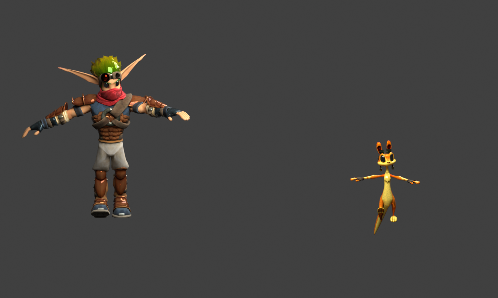

*September 2026. An early Blender rig.*

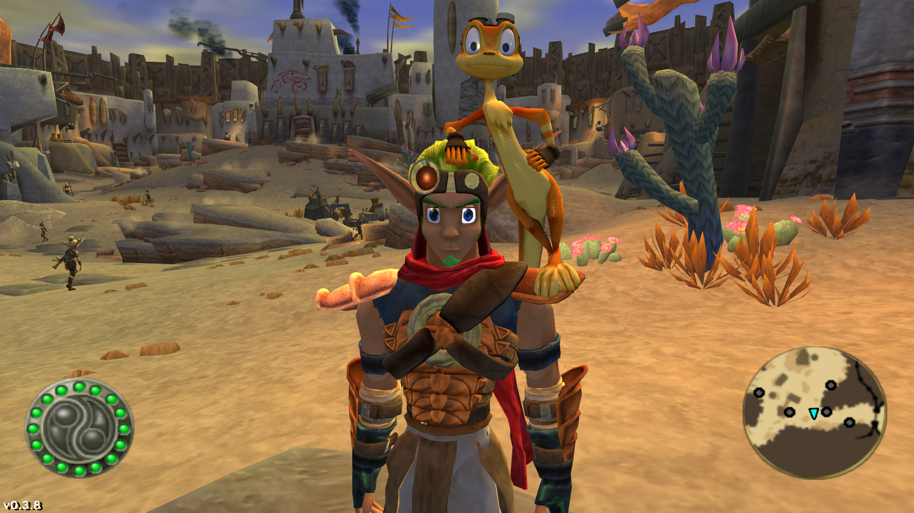

*In-game later that day. A few things were still off.*

## The source models

For Jak 1, I used the cinematic models from Jak II, including Jak’s classic look from the opening cutscene.

*Model views. Gameplay left, cinematic right.*

### Jak 1 · Jak

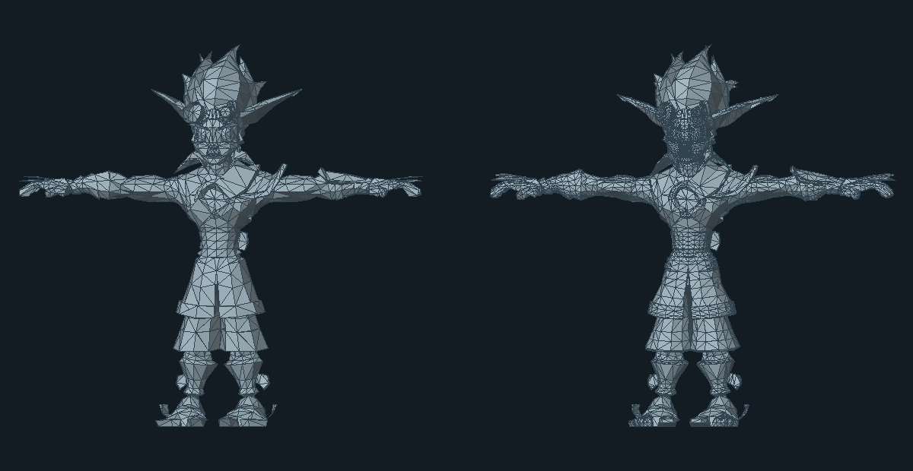

Gameplay: **3,593 triangles** · Cinematic: **9,886 triangles**.

### Jak II · Ashelin

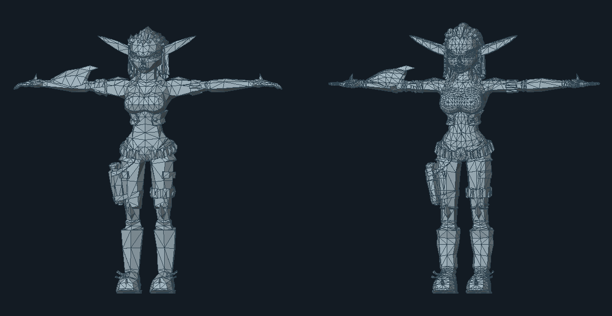

Gameplay: **3,295 triangles** · Cinematic: **10,223 triangles**.

### Jak 3 · Daxter

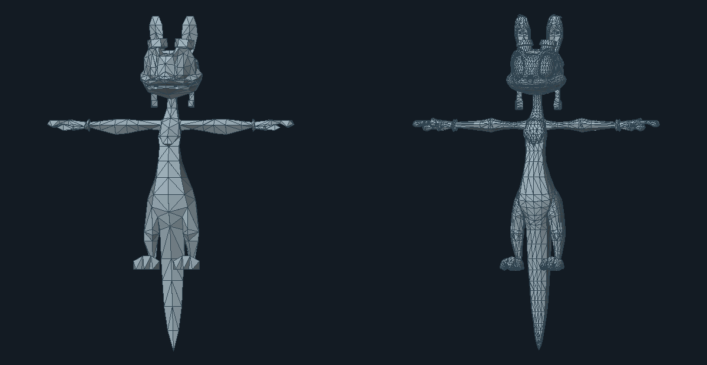

Gameplay: **1,296 triangles** · Cinematic: **9,510 triangles**.

## Faces and bones

The cinematic meshes needed to work with the gameplay skeletons.

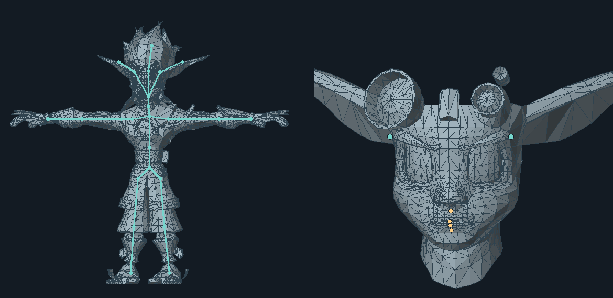

*Jak 1 model view. Bones and brow joints in teal; mouth reference points in gold.*

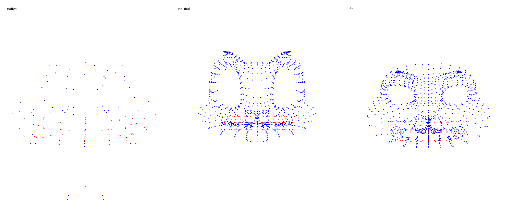

*Left: gameplay expression. Centre: neutral cinematic face. Right: fitted expression.*

I adapted each replacement to its game’s original rig and animation controls. The facial work included fitting cinematic blend shapes to gameplay expressions, plus separate work on eyes, jaws and brows. Daxter’s face above is one example.

## Things got weird

Early Windows builds from October 2026.

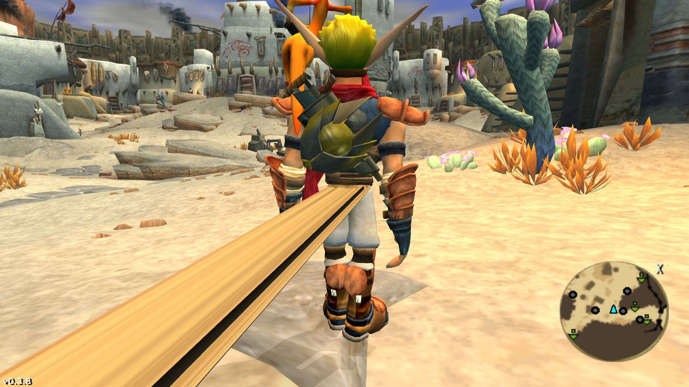

*The skirt was a little long.*

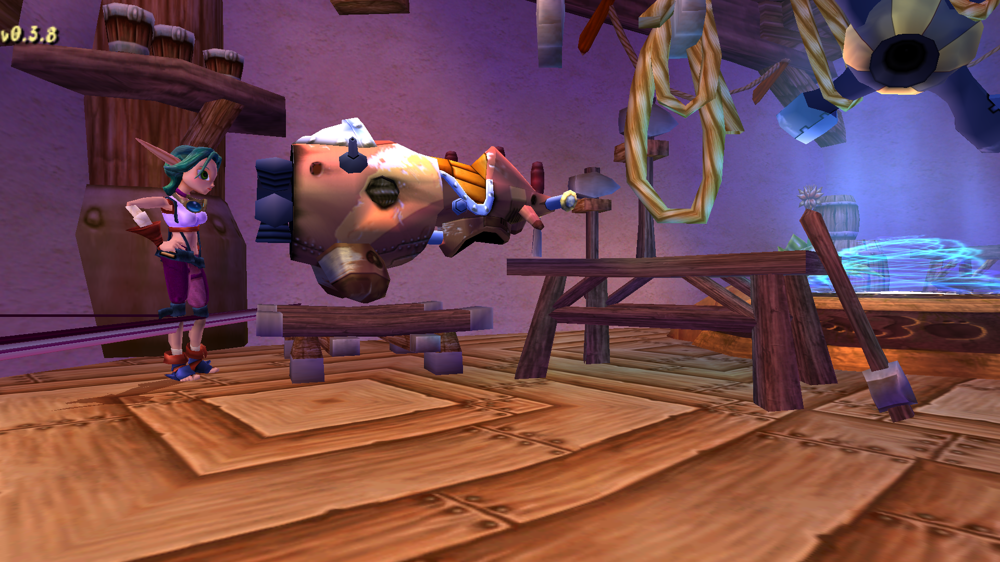

*Keira’s trouser cuff stretched across the workshop.*

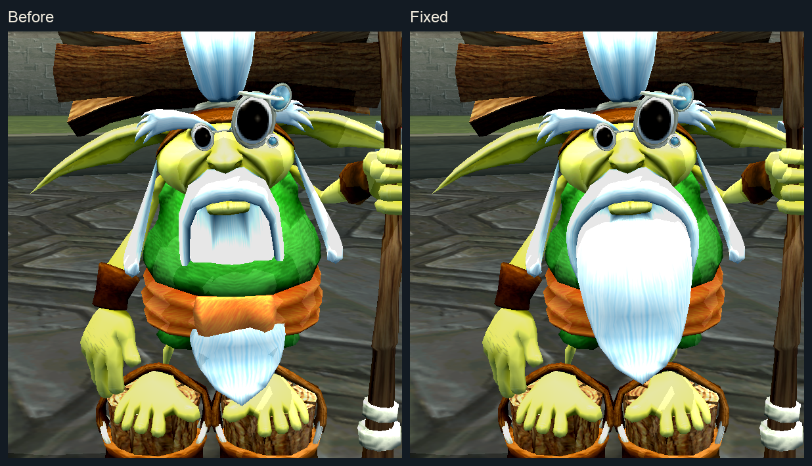

*Samos’s beard went through his belt. Before and after the fix.*

## Getting details right

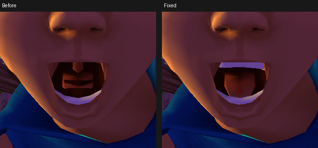

*Jak 1, before and after fixing the mouth and teeth. November 2026.*

## Finished examples

Original on the left, cinematic on the right.

### Jak 1

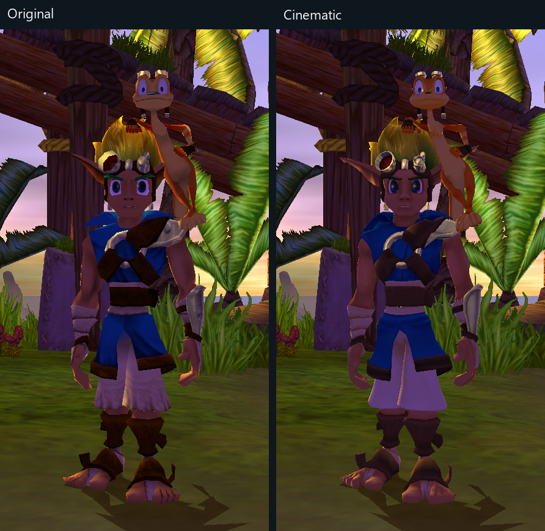

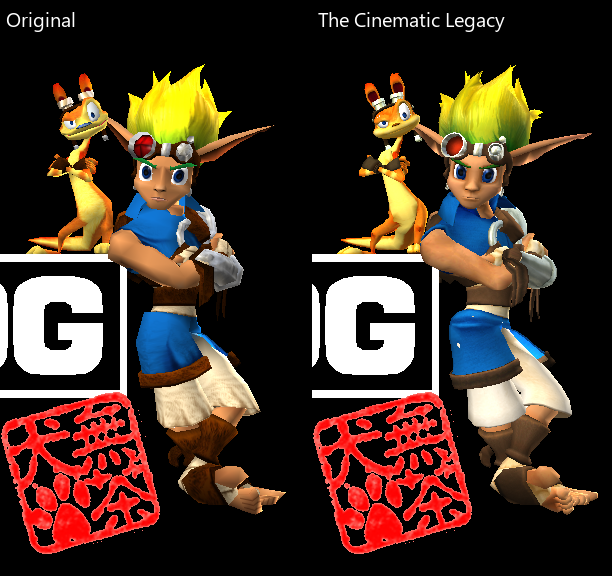

*The final pose in Jak 1’s Naughty Dog intro. Original left, cinematic right.*

### Jak II · Jak and Daxter

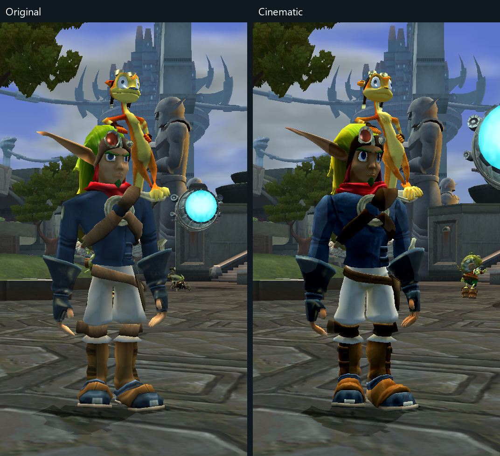

### Jak II · Sig

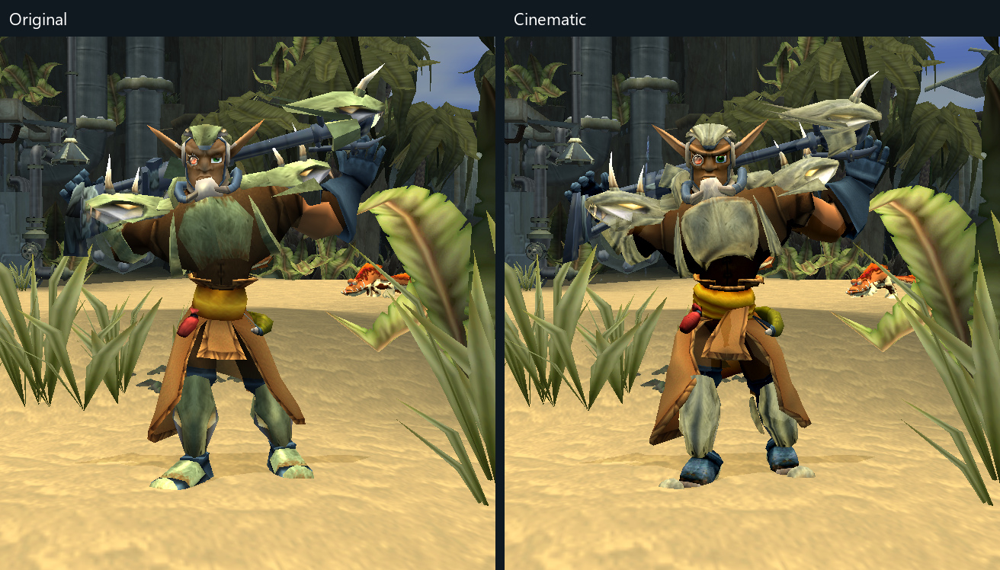

### Jak II · Ashelin

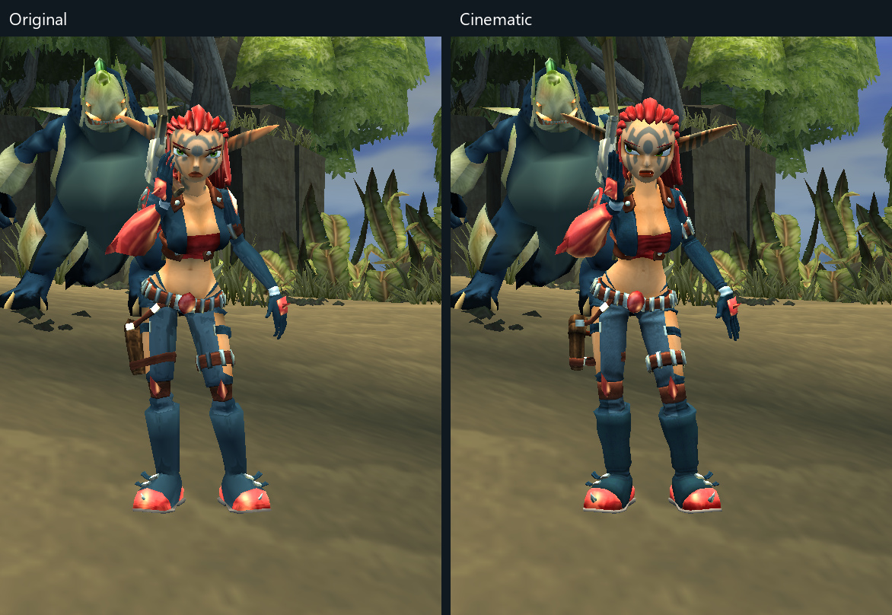

### Jak 3 · Jak and Daxter

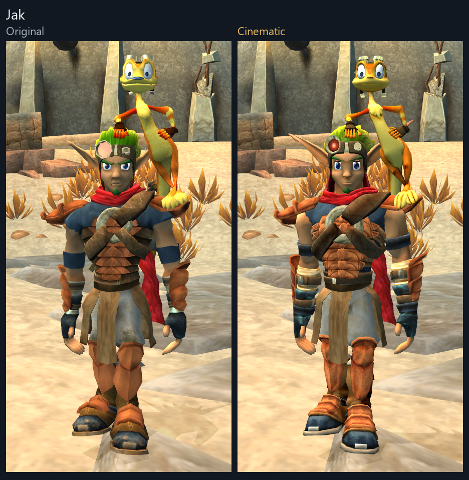

### Jak 3 · Daxter

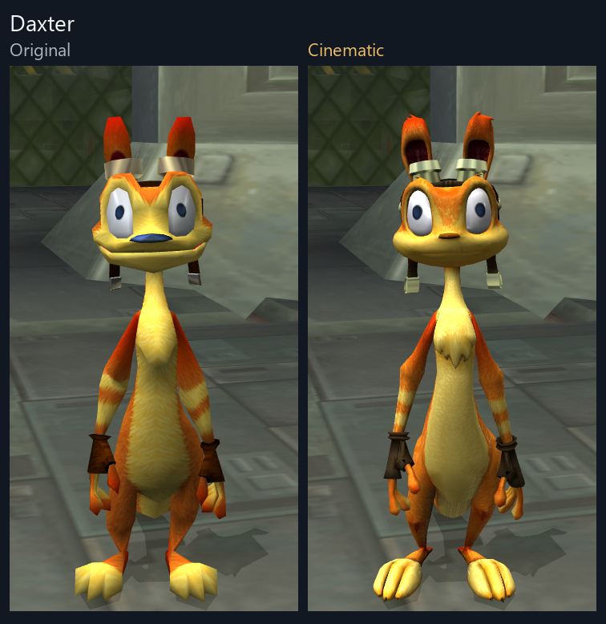

I’ve put a lot of care into checking these models, though full playthroughs still need testing. If I’ve missed anything, just let me know and I’ll get it fixed! I might already be working on a few little touch-ups here and there.
