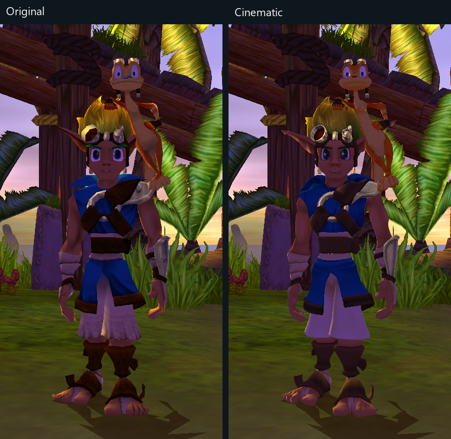
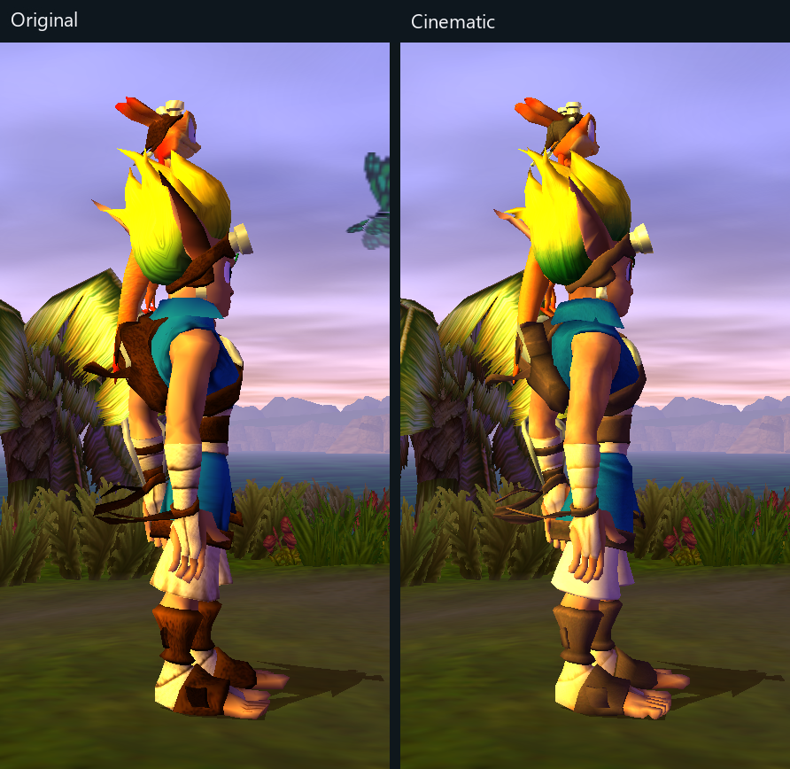
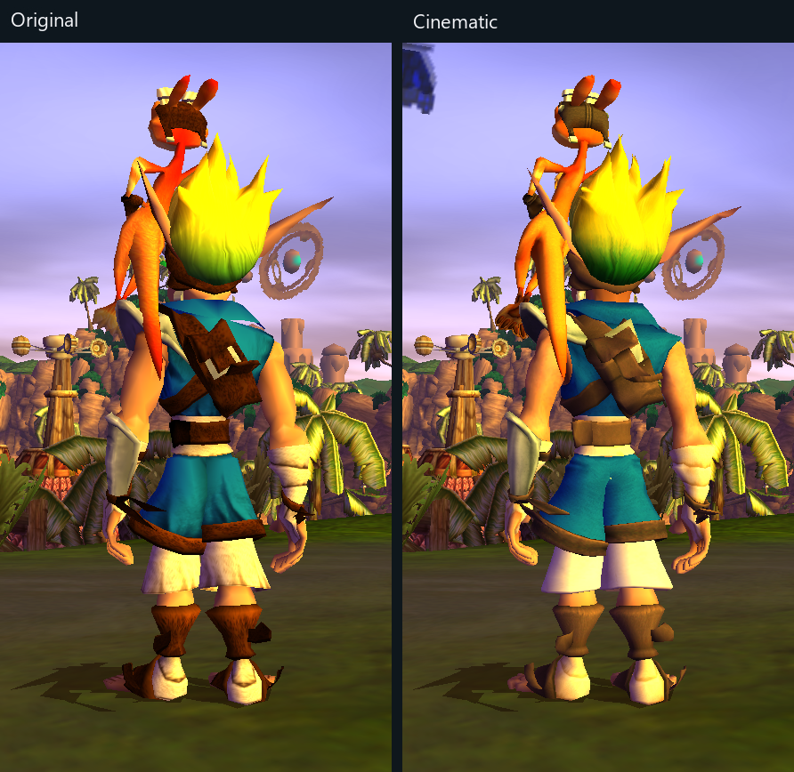
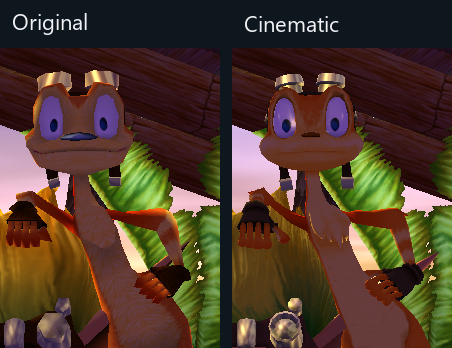
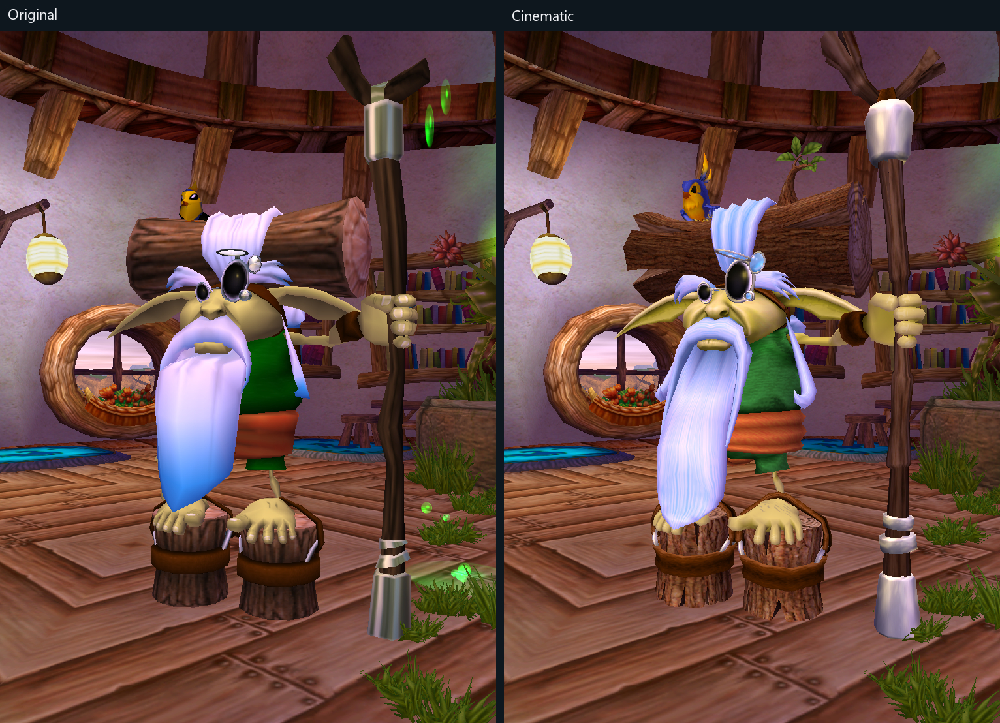
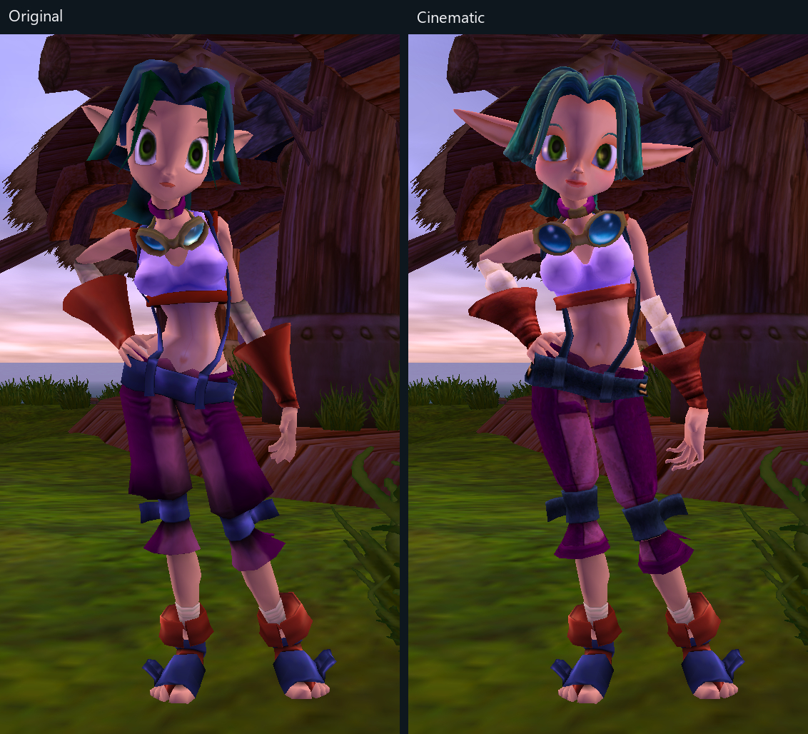
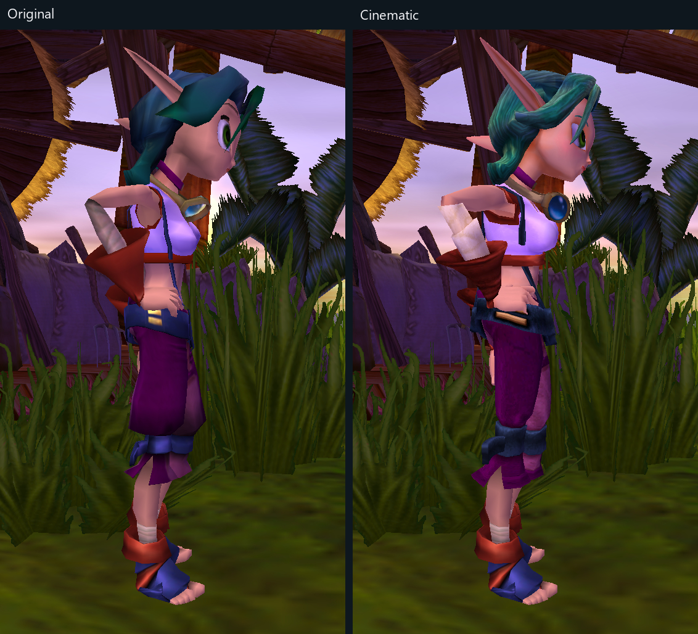
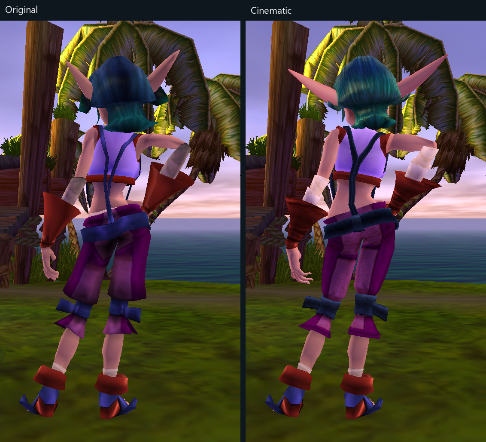
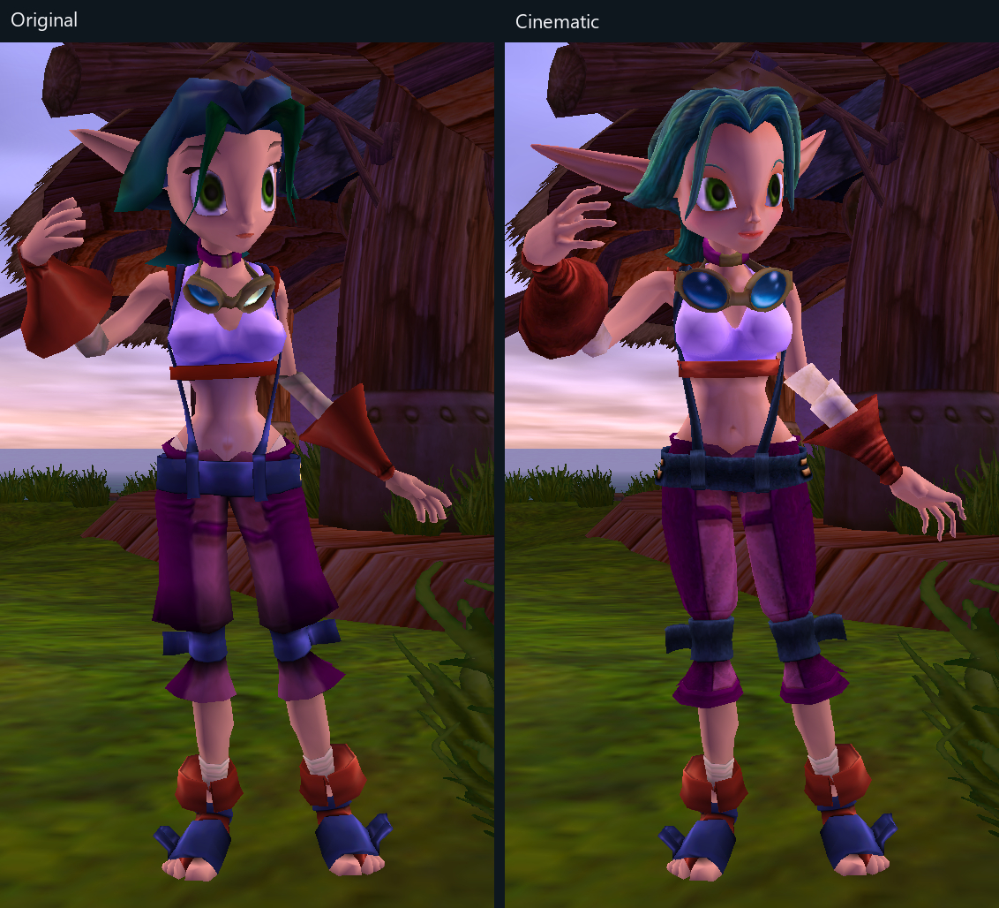
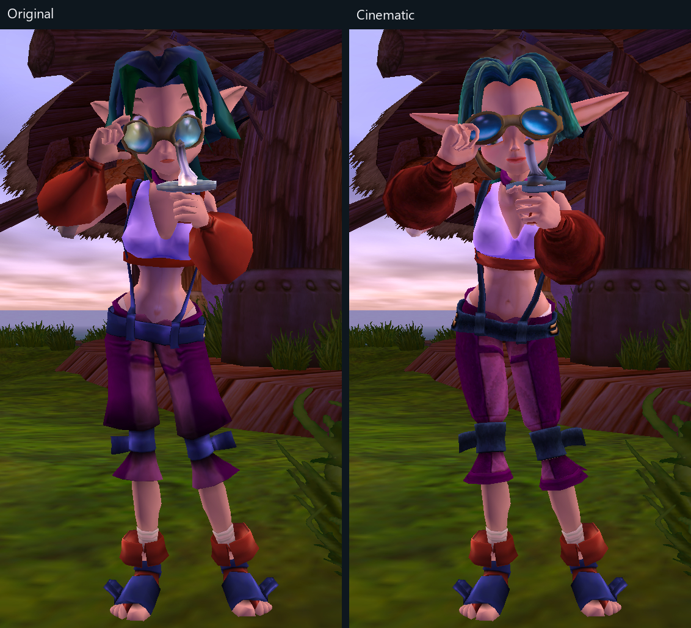

# Jak 1 comparisons

[Overview](../comparisons.md) · [Jak 1](jak1.md) · [Jak II](https://github.com/JacopoBassan/the-cinematic-legacy-jak2/blob/main/docs/comparisons/jak2.md) · [Jak 3](https://github.com/JacopoBassan/the-cinematic-legacy-jak3/blob/main/docs/comparisons/jak3.md)

Original left, Cinematic right. In-game screenshots.

## Jak

**Front**

**Side**

**Back**

## Daxter

**Front**

## Samos

**Front**

## Keira

**Front**

**Side**

**Back**

**Wipe**

**Weld**

