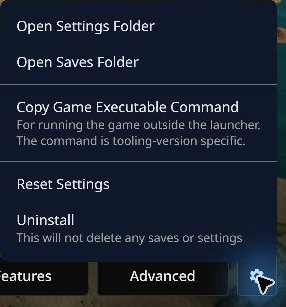
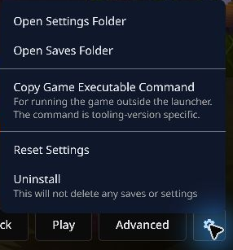

# Continue from your existing save

The launcher keeps vanilla and mod saves in separate folders. You can copy your vanilla OpenGOAL saves into The Cinematic Legacy to keep playing. This has been tested on Windows.

1. Close the game.
2. On the vanilla game page in the launcher, open the cog beside **Advanced** and choose **Open Saves Folder**. Keep that folder open.

   

3. Select **Features → Mods** and open **The Cinematic Legacy** for the same game. Use its cog beside **Advanced** to choose **Open Saves Folder**.

   

4. **Copy** the contents of the vanilla saves folder into the mod’s saves folder. Keep the originals. If the mod folder already has progress you want to keep, make a copy of it before replacing any files.
5. Start the mod and load your save.

If the mod’s **Open Saves Folder** option is missing, run the mod and create a save. Exit the game, return to the Mods list, then open the mod page again.

These steps are for OpenGOAL saves. PCSX2 memory cards use a different format.

[Back to Jak 1](../README.md) · [Back to Jak II](https://github.com/JacopoBassan/the-cinematic-legacy-jak2/blob/main/README.md) · [Back to Jak 3](https://github.com/JacopoBassan/the-cinematic-legacy-jak3/blob/main/README.md)
